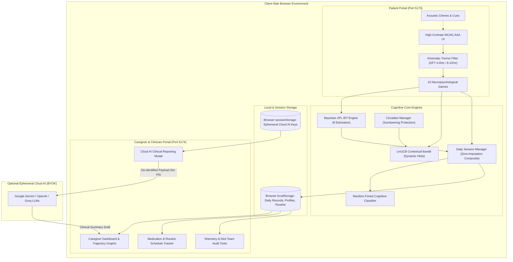
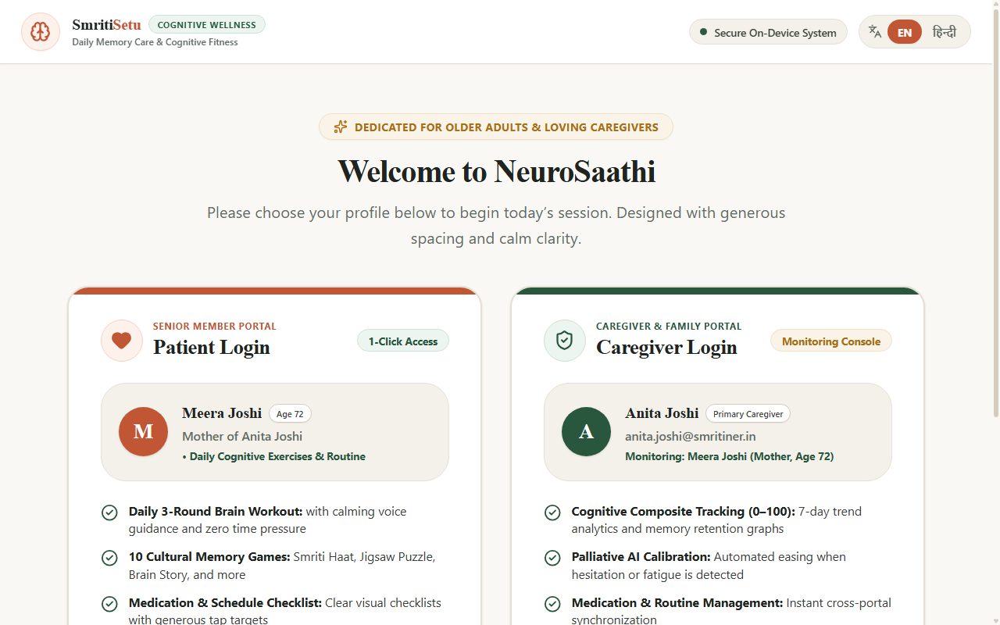
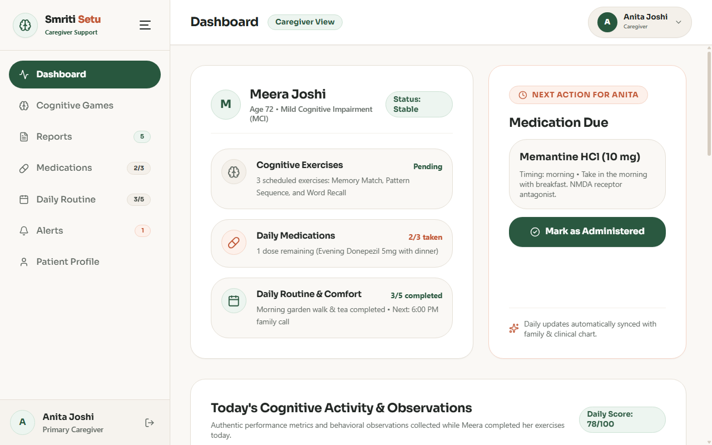
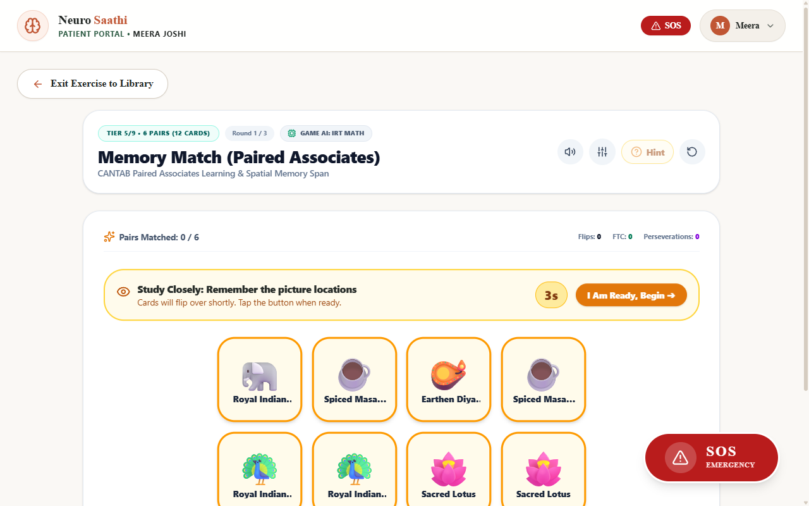

# NeuroSaathi (न्यूरोसाथी / নিউৰোসাথী / নিউরোসাথী)
### AI-Assisted Cognitive Screening Support & Culturally Attuned Memory Care Platform

[](#)
[](#)
[](#)
[](#)
[](#)
[](#)

---

## 📌 Project Overview

**NeuroSaathi** ("Neuro-Companion", also known as Smriti Setu / স্মৃতি সেতু) is an open-source, culturally attuned cognitive screening support and memory-assistance web platform designed specifically for older adults and individuals living with Mild Cognitive Impairment (MCI) or early-stage dementia across the North Eastern Region (NER) of India. Featuring 10 neuropsychologically inspired cognitive exercises rooted in Assamese, Bengali, and North Eastern folklore, geographical landmarks, and daily community traditions, NeuroSaathi combines latent ability estimation (Bayesian 2PL Item Response Theory), real-time contextual bandit scaffolding (LinUCB), digital kinematic tremor filtering, and an accessible dual-portal architecture that fosters patient dignity while providing caregivers and clinicians with longitudinal cognitive monitoring telemetry.

> **Important Clinical & Regulatory Notice**: NeuroSaathi is an experimental cognitive screening support and longitudinal monitoring tool intended for research and supportive care. **It is NOT a certified diagnostic medical device** and does not provide clinical diagnoses or replace evaluation by qualified neuropsychologists or geriatricians. See [docs/VALIDATION.md](docs/VALIDATION.md) for full scientific and validation disclosures.

---

## 🌍 The Problem

Dementia and age-related neurodegenerative disorders represent an escalating public health crisis in India, compounded by distinct regional challenges in the North Eastern Region:

1. **Severe Specialist Shortages**: Geriatricians, clinical neuropsychologists, and memory clinics are concentrated in major metropolitan hubs, leaving rural and hilly areas of the North East severely underserved.
2. **Cultural & Linguistic Disconnect**: Standard computerized cognitive batteries (e.g., Western-developed tools) rely on unfamiliar stimuli (Western animals, foreign street signs, alien cultural references) that introduce severe cultural bias and false-positive impairment classifications.
3. **Pervasive Stigma**: Memory loss is frequently stigmatized or dismissed as normal aging, preventing families from seeking early supportive interventions.
4. **Episodic vs. Continuous Monitoring**: Clinical visits are infrequent (often months or years apart), missing critical day-to-day fluctuations, circadian sundowning episodes, and response to therapeutic routines.

NeuroSaathi bridges this gap by embedding validated neuropsychological paradigms into relatable North Eastern cultural contexts—such as Bihu festivals, tea gardens, Kaziranga wildlife, and local market visits (*Smriti Haat*)—delivered through an accessible, non-threatening digital experience.

---

## ✨ Key Features

- **10 Culturally Anchored Cognitive Games**: Clinically grounded exercises targeting episodic recall, working memory span, visuospatial praxis, executive abstraction, and topographical orientation.
- **Dual-Portal System**: Completely separated interfaces for **Patients** (distraction-free, high-contrast, large touch targets, tremor debouncing) and **Caregivers/Clinicians** (longitudinal analytics, composite scores, medication compliance, circadian tracking).
- **Bayesian 2PL IRT Ability Engine**: Real-time closed-form Maximum A Posteriori (MAP) estimation calculates latent cognitive proficiency ($\theta \in [-3, +3]$) across every trial without floor or ceiling artifacts.
- **LinUCB Contextual Bandit Scaffolding**: Automatically tailors real-time in-game assistance and hint scaffolding based on trial difficulty, time-of-day fatigue, and user deliberation latencies.
- **Kinematic Tremor Compensation**: Software-based Discrete Fourier Transform (DFT) spectral energy isolation separates intentional user taps from 4–6 Hz Parkinsonian resting tremors and 8–12 Hz physiological/essential tremors.
- **Circadian & Sundowning Alert Manager**: Monitors gameplay time-of-day; detects evening cognitive dips (16:30–20:30 Sundowning window) and shifts games to calming, reminiscence-focused modes with ambient warm tones.
- **Client-Side Core Architecture**: Core game logic, kinematic filtering, IRT ability estimation, and session aggregation run in the browser without requiring external server dependencies for core scoring.
- **Optional Privacy-Preserving Cloud AI Reports**: On-demand generative clinical summaries using Bring-Your-Own-Key (BYOK) APIs (Gemini, OpenAI, Groq) stored strictly in ephemeral `sessionStorage` with automated patient de-identification.

---

## 🏛️ System Architecture



---

## 🎮 The 10 Cognitive Games & Clinical Tasks

Each game in NeuroSaathi is inspired by an established neuropsychological paradigm, reimagined using North Eastern cultural assets and community life:

| # | Game | Cultural Theme & Setting | Clinical Reference Paradigm | Primary Cognitive Domain |
|---|---|---|---|---|
| **1** | **Memory Match** *(স্মৃতি মেলা)* | Bihu instruments, Assam silk, hornbill, rhino | Cambridge CANTAB Paired Associates Learning (PAL) | Visuospatial associative learning & episodic retrieval |
| **2** | **Number Recall** *(সংখ্যা স্মৰণ)* | Traditional counting beads and Assamese numerals | WAIS-IV Digit Span (Forward & Backward) | Working memory capacity & phonological loop |
| **3** | **Sequence Recall** *(ক্ৰম স্মৰণ)* | Traditional Brass Bell / Tal percussion patterns | Corsi Block-Tapping Test & Spatial Span | Visuospatial sequential working memory |
| **4** | **Pattern Recall** *(নক্সা স্মৰণ)* | Traditional Gamusa & Mekhela Chador woven patterns | MoCA Visuospatial Matrix Working Memory | Visuoperceptual encoding & matrix pattern completion |
| **5** | **Jigsaw Puzzle** *(চিত্ৰ জোৰা)* | Historic architecture (Rang Ghar, Kamakhya, Majuli) | WAIS-IV Block Design & Rey-Osterrieth praxis | Visuoconstructional praxis & spatial synthesis |
| **6** | **What Changed?** *(কি সলনি হ'ল?)* | Village tea stall (*Dukan*) & traditional kitchen | Rensink Visual Change Blindness & Feature Binding | Visual selective attention & short-term feature memory |
| **7** | **Where Am I?** *(মই ক'ত আছোঁ?)* | Prominent North Eastern landmarks and tea gardens | MoCA Place Orientation & Topographical Wayfinding | Topographical orientation & geographical semantic recall |
| **8** | **Odd One Out** *(অমিল বিচাৰা)* | Indigenous flora, fauna, tools, and textiles | Wisconsin Card Sorting Test (WCST) Abstraction | Executive functioning, rule shifting & category sorting |
| **9** | **Smriti Haat** *(স্মৃতি হাট)* | Weekly community vegetable & spice bazaar | MoCA Delayed Verbal Recall & Market Errand Task | Delayed auditory-verbal recall & semantic categorization |
| **10** | **Brain Story** *(স্মৃতি কাহিনী)* | Folk stories (Tejimola, Lakshminath Bezbaroa tales) | WMS-IV Logical Memory & Reminiscence Therapy | Narrative episodic memory & delayed thematic recall |

---

## 👥 The Two Portals

NeuroSaathi is divided into two distinct portals to serve the divergent needs of patients and their care circles:

### 1. Patient Portal (`http://localhost:5173`)
- **Dignified & Accessible UI**: Adheres to WCAG 2.1 AAA contrast guidelines with large touch targets ($\ge 48\times 48\text{ px}$), gentle color palettes, and uncluttered viewports.
- **Motor Assistance**: Kinematic filtering debounces involuntary hand tremors and provides tactile/auditory feedback for confident selection.
- **Multilingual Support**: Fully localized interface in English and Hindi, with Assamese and regional linguistic themes.
- **Empathetic Feedback**: Positive reinforcement and non-judgmental failure recovery that preserves dignity and prevents test anxiety.

### 2. Caregiver & Clinician Portal (`http://localhost:5174`)
- **Longitudinal Trajectory Tracking**: Dynamic charts illustrating multi-week composite cognitive scores, daily accuracy trends, and deliberation latencies.
- **Domain Breakdown Radar**: Visualizing specific cognitive domains (Episodic Memory, Working Memory, Visuospatial, Executive Function, Orientation) to identify localized decline.
- **Medication & Routine Manager**: Schedule tracking for medications, meal times, hydration, and cognitive exercise regimens with reminder notifications.
- **Circadian & Sundowning Monitor**: Logs the time-of-day distribution of sessions to spot late-afternoon agitation or fatigue patterns.
- **Exportable Clinical Reports**: Generates structured clinical summaries formatted for review during physician consultations.

---

## 🚀 Getting Started

### Prerequisites
- [Node.js](https://nodejs.org/) (version 18.0.0 or higher recommended)
- `npm` (version 9.0.0 or higher)

### Installation
Clone the repository and install dependencies:
```bash
git clone https://github.com/parth-ner/smriti-ner.git
cd smriti-ner
npm install
```

### Running the Application

#### Option A: Unified Single-Origin Mode (Recommended for Production & Unified Dev)
NeuroSaathi supports unified single-origin routing. Both portals and authentication run on a single host and port with zero iframe bridging:
```bash
npm run dev
```
- **Patient Portal**: [http://localhost:5173/patient](http://localhost:5173/patient)
- **Caregiver Portal**: [http://localhost:5173/caregiver](http://localhost:5173/caregiver)
- **Login / Landing**: [http://localhost:5173/login](http://localhost:5173/login)

#### Option B: Dual-Port Development Architecture (`npm run dev:both`)
To run both the **Patient Portal** and **Caregiver Portal** concurrently on dedicated ports (5173 and 5174) with the hardened cross-port storage relay:
```bash
npm run dev:both
```
- **Patient Portal**: Open [http://localhost:5173](http://localhost:5173) in your browser.
- **Caregiver Portal**: Open [http://localhost:5174](http://localhost:5174) in your browser.

Alternatively, start individual dev ports:
```bash
# Patient Portal only (port 5173)
npm run dev:patient

# Caregiver Portal only (port 5174)
npm run dev:caregiver
```

### Building for Production
```bash
npm run build
```

### Running Linter & Automated Test Suites
NeuroSaathi includes comprehensive unit tests, game engine verifications, and adversarial stress audits:
```bash
# Run Oxlint static analysis
npm run lint

# Run all test suites (engines + red-team audits)
npm test

# Run game engine tests individually
npm run test:engines

# Run adversarial simulation audits
npm run test:audits
```

---

## 🔐 Optional Cloud AI Configuration (BYOK)

NeuroSaathi operates with local client-side algorithmic scoring by default. For advanced narrative clinical synthesis, caregivers can optionally supply their own API credentials:

- **Supported Providers**: Google Gemini (`gemini-2.5-flash`), OpenAI (`gpt-4o-mini`), and Groq (`llama-3.3-70b-versatile`).
- **Zero Disk Persistence**: User-provided API keys are kept strictly in browser `sessionStorage`. They are never written to `localStorage`, never sent to any intermediary backend, and are automatically purged when the browser tab is closed.
- **Automated De-Identification**: All generative prompts strictly sanitize patient data prior to dispatch:
  - Patient names are systematically replaced with the neutral token `"the patient"`.
  - Caregiver contact details, phone numbers, emails, and personal notes are completely excluded from API payloads.
- **Explicit Consent**: A mandatory one-time consent modal explicitly notifies the user before any anonymized gameplay metrics are transmitted to a third-party LLM provider.

---

## 📸 Screenshots & Demo

### Visual Interface Showcase

| Patient Portal | Caregiver Portal |
| :---: | :---: |
|  |  |
| *Accessible, distraction-free patient interface* | *Longitudinal monitoring & composite score analytics* |

| In-Game Experience (Memory Match) |
| :---: |
|  |
| *Paired-associates task with Assamese cultural iconography* |

### Demo Video Walkthrough
> 📺 **Demo Video**: [Watch the NeuroSaathi Walkthrough on YouTube (Link Coming Soon)](https://youtu.be/placeholder-neurosaathi)

---

## ⚠️ Limitations & Scientific Disclosures

NeuroSaathi is an engineering prototype and research platform. Review the complete [docs/VALIDATION.md](docs/VALIDATION.md) for detailed methodology. Please take note of the following limitations:

1. **Not a Diagnostic Medical Device**: NeuroSaathi does not diagnose Alzheimer's disease, vascular dementia, or any other medical condition. It is designed to assist caregivers and clinicians by gathering supplementary behavioural data.
2. **Synthetic Telemetry Training Baseline**: The client-side random forest cognitive classifier was trained using synthetic gameplay telemetry features mapped against real-world demographic and clinical covariates from the Washington University OASIS-2 longitudinal dataset. Real OASIS-2 participants did not play these digital games.
3. **Simulation Consistency Checks**: Audit benchmarks demonstrate internal algorithmic reliability and mathematical consistency across synthetic agents, but do not substitute for empirical clinical trials.
4. **Local Prototype Storage**: In its current iteration, patient records are stored locally within the browser (`localStorage`). Multi-device cloud synchronization, encrypted remote backups, and FHIR interoperability require future enterprise backend deployment.
5. **Next Steps**: Formal observational pilot studies under Institutional Review Board (IRB) / Ethics Committee approval with clinician oversight across clinical centers in North East India.

---

## 📄 License & Attribution

This project is open-source under the [MIT License](LICENSE).

Developed with dedicated respect for the cultural heritage and elderly communities of Assam and the North Eastern Region of India.
